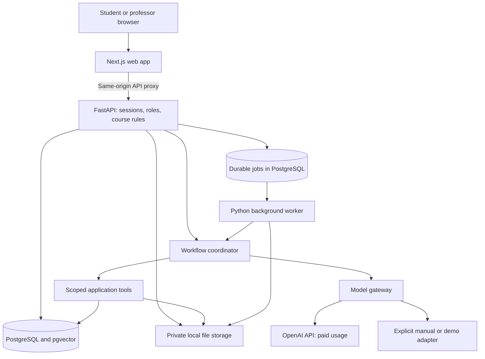
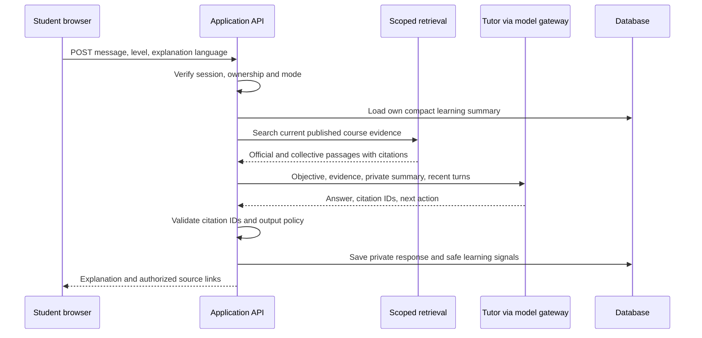
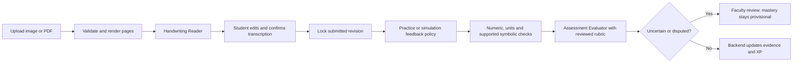
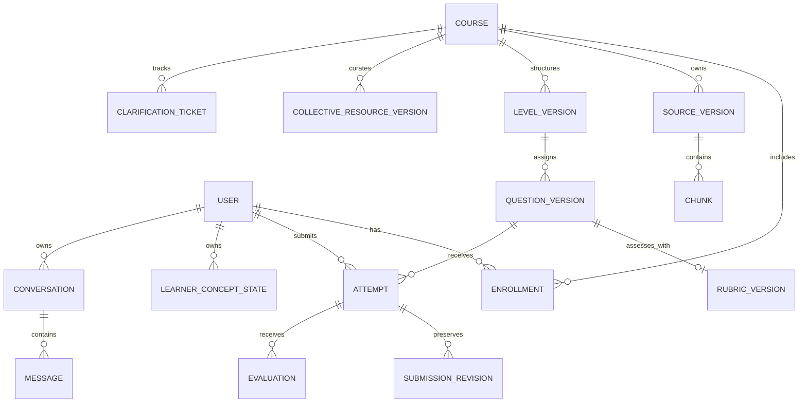

# Physics 1 web application: prototype implementation plan

For the current AI implementation proposal awaiting user review, see [AI agents implementation plan](docs/AI_AGENTS_IMPLEMENTATION_PLAN.md). It updates the agent integration approach to the actual Python/SQLite prototype and keeps Kinematics as the only playable level.

Status: implementation specification, not a built application. Updated 7 November 2026. This plan narrows the earlier general portal plan.

**Current implementation scope supersedes the broader roadmap below:** the user requested construction of the kinematics level only. A working local draft is now in [kinematics/](kinematics/README.md), with six core units, one optional unscored extension, six numeric checkpoints, source-page previews and a two-task boss. The initial slice uses a buildless frontend and a standard-library Python/SQLite backend to avoid dependencies and paid services. The proposed cohort stack, live agents, additional levels and handwriting workflows below remain future work, not implemented features. No other course level is to be constructed under the current scope.

The latest requested expansion adds a Physics I overview with visible level/progress cards and a professor/admin course studio with persistent draft creation and private PDF/PPTX uploads. The additional level cards are outline metadata only. Studio ownership is scoped to the local browser session; institutional role authentication, AI document processing and course publication remain unimplemented.

## 1. Confirmed scope and constraints

- One Physics 1 course, one professor and eventually 10–30 students; initially a local demonstration.
- Host: the user's MacBook Air M5, 16 GB RAM. No paid hosting or managed database required.
- English official PDF slides, practice questions and past/proposed exams. Some questions have official solutions; some do not.
- English course terminology and assessment prompts, with explanations in the student's chosen language. Keep the original English sources visible.
- Handwritten solution uploads are part of the prototype.
- The user is the academic reviewer for the initial demonstration. Record approvals as demo-reviewer approvals, not professor approvals.
- The user supplied `/Users/yusufdenizcelik/Downloads/Material (5)` as a local folder. Initial inspection found 65 files: 57 PDFs (1,697 pages), six PowerPoint decks (41 slides), one spreadsheet and one lecture video. See [materials review](docs/MATERIALS_REVIEW.md), [manifest](docs/materials-manifest.json) and [first-unit draft](docs/LEVEL_01_KINEMATICS_DRAFT.md). Original files remain unchanged; no provider ingestion has occurred.
- The user confirmed these are all available materials. Mark fluid mechanics as a source gap for now: keep its level incomplete and require reviewed supporting evidence before publishing theory or using questions for mastery scoring.
- Students choose assisted practice or exam-simulation mode.
- The user can provide an OpenAI API key now. Use OpenAI as the primary planned AI provider, with a manual/demo adapter for development without paid calls. An API key does not provide free usage; paid inference is separate from zero hosting cost.
- No API key has been received, no provider calls have been authorized through this plan, and no infrastructure has been provisioned. Never request that the key be pasted in chat or committed to source control.

## 2. What constitutes a working prototype

The app must have persistent accounts, real PDF ingestion, a reviewed course map, page-cited tutoring, an editable question bank, handwritten submissions, formative feedback, progress/XP, and a faculty review/analytics screen. Navigation alone and prerecorded chat responses do not constitute the AI-enabled prototype.

Build the full syllabus map and support retrieval across every approved uploaded course source. Author and review three complete representative levels first: one kinematics level, one dynamics/energy level, and one thermodynamics level. This tests prerequisites, diagrams, vector reasoning and course-specific thermodynamic conventions before expanding authored lessons across the syllabus. Other levels remain visibly unpublished until reviewed.

Initial demonstration corpus target: 2–3 slide sets, approximately 15–25 practice questions, 4–6 exam questions, and 5–10 representative handwritten solutions. These are planning targets, not assumptions that these files already exist.

The successful demo is: professor imports sources → approves the proposed structure → reviews and publishes a level → student asks a multilingual question with source citations → uploads handwritten work → confirms transcription → receives reviewed-rubric feedback → progress changes → repeated aggregate difficulty appears in the faculty queue.

## 3. Proposed full syllabus map

These are draft levels, not a replacement for the professor's syllabus or approved ordering. Each level is further divided into short objectives, theory units and checkpoints.

| Level | Topics from the supplied curriculum |
|---|---|
| 1. Measurement and uncertainty | Experimental method, observables, dimensions, units, statistical/systematic errors and uncertainty propagation |
| 2. Vectors and one-dimensional kinematics | Vector review, reference frames, position, displacement, velocity, constant/variable acceleration |
| 3. Motion in two and three dimensions | Polar/cylindrical coordinates, tangent/normal acceleration, curvature, circular motion and velocity/acceleration composition |
| 4. Newton's laws and force models | Inertial frames, mass/force, constraints, gravity, elastic forces, static/kinetic friction and viscous resistance |
| 5. Non-inertial frames | Relative motion and fictitious forces, with links back to kinematic composition laws |
| 6. Work and energy | Work, kinetic energy, work–energy theorem, conservative fields, potential and mechanical-energy conservation |
| 7. Oscillations | Harmonic motion, damped/driven motion and resonance |
| 8. Momentum, torque and angular momentum | Impulse, linear momentum, torque and angular-momentum theorem |
| 9. Gravitation | Universal gravitation, Kepler's laws, inertial/gravitational mass, superposition, fields/flux, potential, Gauss' theorem and symmetric distributions |
| 10. Many-particle systems | Discrete/continuous systems, internal/external forces, center of mass, momentum/angular-momentum laws, energy and angular momentum in the center-of-mass frame |
| 11. Collisions | Elastic/inelastic collisions, momentum and kinetic-energy accounting |
| 12. Rigid-body dynamics | Translation, fixed-axis rotation, moment of inertia, parallel-axis theorem, kinetic energy and rolling with/without slipping |
| 13. Rigid-body equilibrium | Force/torque balance, mechanical equilibrium and conservation-law applications |
| 14. Fluids | Pressure, Stevin/Pascal/Archimedes, streamlines/flux tubes, continuity, Bernoulli and viscosity |
| 15. Thermal foundations and calorimetry | Thermometry, heat transfer, equilibrium, state variables, reversible/irreversible processes, calorimetry |
| 16. First law and ideal gases | Internal energy, work, ideal-gas kinetic theory, adiabatic/isothermal/isobaric/isochoric processes and first-law applications |
| 17. Second law and cycles | Kelvin/Clausius statements, engines, refrigerators, efficiency, Carnot/other cycles, Carnot's theorem and thermodynamic temperature |
| 18. Entropy | Clausius' theorem, entropy, reversible/irreversible processes and synthesis problems |

Store prerequisites as a graph, not only a linear list. Examples: vectors → multidimensional motion → dynamics; energy + circular dynamics → orbital problems; forces + torque → rigid-body equilibrium; thermal foundations + first law → cycles → entropy. Students can jump to released checkpoints/bosses; the graph informs remediation rather than forcing every lesson.

Every level has an exam-style boss; the course also offers a mixed-topic exam simulator assembled from eligible reviewed questions. Genuine past exams, proposed exams and AI-generated variants have distinct provenance labels.

## 4. Screens and user journeys

| Route | Screen and behavior |
|---|---|
| `/login` | Local invited accounts; professor and student roles; no public signup needed |
| `/course` | Map/list of levels, publication status, readiness, XP and next suggested action |
| `/levels/:id` | Objectives, prerequisite links, learn / ask / checkpoint / boss entry points |
| `/study/:id` | Three panes: course outline, cited tutoring/lesson, source PDF page or diagram; adjustable on smaller screens |
| `/practice/:id` | Numeric/expression/unit input, typed working, handwriting upload, transcription confirmation, hints and feedback |
| `/exam/:id` | Practice or simulation selection, timer, question navigation, autosaved answers and final submission |
| `/progress` | Concept-level evidence, assisted vs independent results, review tasks, XP and in-app reminders |
| `/faculty/sources` | PDF upload, question/solution separation, extraction preview, source classification and approval |
| `/faculty/course-map` | AI-proposed levels/prerequisites, source coverage and structure approval |
| `/faculty/review` | Lesson/question/rubric editor, source comparison, preview and explicit publication |
| `/faculty/insights` | Aggregate FAQs, misconception clusters, slow/problematic questions, resource proposals and clarification queue |
| `/settings` | Explanation language, accessibility, quiet hours and private learning preferences |

English remains the navigation/assessment default. Multilingual tutoring includes the English technical term alongside translated terminology. A student's explanation language must not affect scoring criteria. In simulation mode, the server freezes prompt language and hint policy; translating an exam prompt is only allowed if the professor has enabled it.

The professor may inspect submitted assessment work and corrected transcriptions for teaching review. Private tutoring conversations are not visible in the ordinary faculty UI. Show this distinction to students.

## 5. Technical architecture

Use one repository with a Next.js frontend, a FastAPI application, a background worker and local PostgreSQL with pgvector. Keep domain logic and the model gateway in Python so document processing and physics checks do not require an extra service.



Proposed libraries: Next.js/TypeScript, Tailwind, KaTeX for formulas, PDF.js for approved source viewing; FastAPI/Pydantic, SQLAlchemy/Alembic, PostgreSQL full-text search + pgvector, Pint for quantities and a restricted symbolic-checking layer backed by SymPy. Use pypdf for extraction and PDFium rendering for page previews; benchmark extraction on actual files before finalizing the parser. Rendering whole pages preserves vector diagrams that are not embedded image objects.

Local development: run Next.js and Python processes natively with PostgreSQL in a lightweight container, or use a Compose profile for all services. Keep one worker initially. Files and database volumes persist across restarts. Bind to localhost; remote hosting and TLS are later deployment work. This local setup does not serve 30 remote concurrent students.

Private files are served by an authenticated API endpoint after authorization. Never expose the upload directory as static/public assets. Question-only derivatives must contain no hidden text, thumbnails, embedded attachments or original solution pages; validate those derivatives before release. An authorized page view must not provide a download of a restricted mixed question/solution original.

## 6. The six application agents

An agent here is a server-side task definition: instructions, permitted tools, input/output schema, model configuration, run limits and an audit record. These six roles do not require six models, six always-running processes or six calls per student message. The backend chooses the workflow from the authenticated action. Deterministic application code controls publication and progress.

| Agent | Trigger | Permitted inputs/tools | Output and limits |
|---|---|---|---|
| Course Builder | Professor requests a structure or draft level | Approved official passages, syllabus graph, extracted question metadata | Draft level graph, objectives, lessons, question mappings and candidate rubrics. Cannot publish or invent official answers. |
| Physics Tutor | Student asks a question or requests a practice hint | Published official retrieval, approved collective resources, own learner summary, bounded calculator | Cited explanation, next action and optional misconception signal. No other student's data or restricted solution access. |
| Handwriting Reader | Student uploads a solution | Only that submission's rendered pages and question prompt, without the reference answer | Transcription, equation blocks and ambiguous regions. Must not repair wrong mathematics or grade. Student confirmation required. |
| Assessment Evaluator | Confirmed submission, at the permitted feedback stage | Immutable submitted work, professor-reviewed rubric/reference, unit/numeric/symbolic check results | Criterion-level feedback and provisional result. No direct XP/mastery write or general access to private chat. |
| Cohort Curator | Scheduled/manual batch after sufficient activity | Sanitized structured signals, thresholded aggregates, published official sources | FAQ/resource drafts, misconception groups and clarification tickets. No raw private chat retrieval; cannot publish. |
| Resource Scout | Professor/student proposes a URL, or professor requests resource suggestions | Allowlisted public-page fetches and official concept references | Supplementary resource candidates with provenance and caveats. No authority promotion; faculty must approve. |

Retrieval, authorization, arithmetic/unit checking, scheduling, XP and publication are application services. Adding a separate AI agent for each would increase cost and introduce unnecessary uncertainty. Ordinary tutoring generally uses one generation call after retrieval; handwriting and assessment are distinct runs when requested.

Resource discovery initially uses faculty-curated URLs and user-suggested links. A later paid search integration may discover new links. Without search, do not present model-invented URLs as verified resources. URL fetching rejects private-network destinations and unsafe redirects.

## 7. How agents connect to the app

Use a provider-independent `ModelGateway` with operations such as `generate_structured`, `stream_explanation`, `transcribe_pages` and `embed_passages`. Implement `OpenAIAdapter` and an explicitly labeled `ManualDemoAdapter`. Persist app state in PostgreSQL rather than relying on provider conversation memory.

The OpenAI adapter uses the Responses API. Function calling connects selected agents to backend functions; the application validates and executes the requested tools and returns their results to the model. Schemas define outputs such as lesson drafts, transcriptions and rubric evaluations. Structured output validates shape, not factual correctness. [Function calling](https://developers.openai.com/api/docs/guides/function-calling), [Structured Outputs](https://developers.openai.com/api/docs/guides/structured-outputs)

Do not make the prototype depend on a hosted agent builder or a separate agent service. Explicit workflow functions and a tool registry are sufficient. If orchestration later grows, an Agents SDK can represent the same roles; manager/specialist orchestration is documented, but is optional here. [Agent orchestration](https://developers.openai.com/api/docs/guides/agents/orchestration)

Example app-owned tools:

```text
search_official(query, concept_ids, limit)
search_collective(query, concept_ids, limit)
load_own_learning_summary()
load_permitted_source_page(source_version_id, page)
check_quantity(answer_ast, expected_quantity_id)
check_expression(answer_ast, expected_expression_id)
propose_draft(resource_type, payload)
propose_clarification(affected_item_id, reason)
```

`student_id`, roles, course scope and publication permissions come from server session context, never model-supplied tool arguments. The evaluator receives reference material through a separate workflow unavailable to the tutor. No agent has a `publish`, `grant_role`, `award_xp` or unrestricted SQL tool.

A run envelope stores `run_id`, actor, task, source/rubric versions, prompt/schema version, model, bounded input references, status, usage and error reason. Keep raw student text and images out of general tracing/analytics. Scope private run details to authorized users.

The model gateway rejects calls without configured credentials or an enabled spending allowance. The server checks concurrency, input/output limits and available budget before dispatch. Tool loops have a maximum number of steps and timeout; failures return a recoverable UI state, not an invented success.

## 8. Main request sequences

### Cited tutoring



During implementation, stream progress/status immediately and show answer text as provisional until final citation validation. Only validated final output is saved as complete. Do not store or score partial output after a canceled/failed request.

### Handwritten work



Store the original upload, transcription revisions, confirmation and submitted snapshot. The reader must flag uncertain signs, exponents, subscripts, vector arrows, units and diagram labels; it must not silently correct a student's error. Diagram understanding can require faculty review even after text confirmation.

Practice mode provides stepwise hints and feedback. Exam simulation freezes the question set/version and timing rules, autosaves responses, withholds hints and evaluation feedback until final submission, and records independence. Confirmation of what the student wrote remains available without tutoring. Do not claim the simulator prevents external AI use or constitutes proctoring.

## 9. Physics-aware assessment

Treat a question as more than its final numerical answer. Store known quantities, requested quantity, accepted unit/dimension, coordinate conventions, assumptions, significant-figure/tolerance rules and rubric criteria.

Checks run in this order:

1. Confirm interpretation/transcription and required assumptions.
2. Normalize quantities and compare compatible units; distinguish temperature values from temperature differences.
3. Check numeric tolerance and supported symbolic equivalence with declared variable domains; test vector components in the specified frame.
4. Evaluate physical setup, conservation-law applicability, sign conventions and reasoning against the reviewed rubric.
5. Return separate feedback for setup, method, mathematics and final result. Flag disagreement between deterministic checks and AI evaluation.

Thermodynamic work/heat conventions, gravitational-potential reference choices, friction models, fluid idealizations and uncertainty rules come from this course's reviewed sources. Do not substitute a generally familiar convention if it differs from the slides. Meaningful missing assumptions cause clarification rather than automatic failure.

SymPy parsing can invoke evaluation; never pass untrusted strings to `eval`, `sympify` or `parse_expr`. Accept a limited mathematical grammar, construct a validated AST, allowlist operators/functions, and run resource-limited symbolic work without network access or secrets. Unsupported expressions return `needs_review`, not `incorrect`. [SymPy parsing warning](https://docs.sympy.org/latest/modules/parsing.html)

Questions with official solutions still need import validation and an approved rubric. For questions without a solution, the Course Builder may draft a reference and the checker may test it, but professor approval is required before mastery scoring. Until then, mark the question unscored exploration or keep it unpublished. Generated solution text is never labeled official.

## 10. Course-wide RAG and knowledge boundaries

Maintain separate official, collective and private data paths. Raw feedback is analytics input; it is not indexed as course truth. Keep restricted answer keys out of student-searchable indexes and out of the Tutor's permitted tools.

Import records contain source checksum/version, pages, bounding boxes, extraction quality, concept links, source type and access classification. Classify PDFs as slides, practice questions, past exams, proposed exams and solution material. Mixed files require question/solution separation and human inspection before release.

Chunk by concept/derivation, initially about 300–700 tokens with parent-section links, and retain equation definitions and page/diagram references. Start with PostgreSQL full-text retrieval as the no-provider-cost baseline. Add embeddings through the gateway when API use is enabled, keeping embedding model and dimensions versioned. A change of embedding model requires reindexing; do not mix incompatible vectors.

Retrieve around 6–10 evidence passages initially, rerank if needed, and expand deliberately for multi-part or prerequisite questions. Treat these as benchmark starting points, not guarantees. Search the whole authorized course when appropriate even if the student is currently in one level. Fetch selected page images for visual questions; do not repeatedly send every slide to the model.

Use original page citations as evidence. Generated summaries and translated explanations link back to those originals. If the student's query is in another language, derive English course search terms and preserve the requested output language. When retrieval finds no adequate source, the tutor states the gap and may suggest a reviewed supplementary resource.

Private memory is a compact concept profile plus recent relevant attempts and a short conversation summary. Shared caches contain approved explanations or evidence packages, keyed by course/source version, access/release scope and language. Personalized answers remain private. Withdrawn/corrected sources invalidate derived resources and caches.

## 11. Database scheme and access policy



Additional tables: concepts/prerequisites, source locations, question-to-concept mappings, evidence dependencies, approvals, model runs, durable jobs, XP events, privacy-safe learning signals and reminder settings. Questions may be reused across sets through an assessment membership table; the diagram shows the main relationships only. Rubric versions are pinned by evaluations, and publication references exact lesson/question/source versions.

Private tables require ownership checks and database row policies. Faculty access is separately granted to submitted assessment artifacts and permitted analytics; roles do not imply access to private tutoring. Source/collective tables filter by course, approval, release and audience. Restricted references are available only to the evaluation service workflow. Use separate database privileges for normal requests, workers and migrations; setting a role name inside a prompt grants nothing.

Sessions use hashed passwords and opaque server-side session tokens in HttpOnly cookies, with CSRF/origin checks on mutations. Demo accounts are seeded through a setup command; secrets are never committed. Local demo role switching is confined to demo data and disabled for real users. Authentication is preserved even when running on localhost.

## 12. API and event contracts

| Endpoint | Behavior |
|---|---|
| `POST /api/sources` | Professor upload; return source and ingestion-job IDs |
| `GET /api/jobs/:id` | Authorized job progress/error state |
| `POST /api/course/blueprint-drafts` | Queue Course Builder against selected source versions |
| `POST /api/reviews/:id/approve` | Record authorized approval of an exact draft version |
| `POST /api/levels/:id/publish` | Verify required approvals and create publication |
| `POST /api/conversations/:id/messages` | Private tutor run; stream status and validated answer |
| `POST /api/attempts` | Create attempt with immutable practice/simulation policy |
| `POST /api/attempts/:id/uploads` | Store private handwriting artifact and queue transcription |
| `PATCH /api/attempts/:id/transcription` | Save editable revision before final submission |
| `POST /api/attempts/:id/submit` | Confirm revision, finalize answer and queue permitted evaluation |
| `POST /api/exam-sessions/:id/submit` | Finalize the whole simulation and release feedback jobs |
| `POST /api/feedback` | Helpfulness, content issue or score dispute |
| `GET /api/faculty/insights` | Authorized aggregate results with sample-size suppression |

Every mutation rechecks session and ownership/role; IDs alone never authorize access. Return `202 Accepted` for long-running work. Use idempotency keys for uploads, submissions, publication and XP-producing operations.

Job states: `queued → running → succeeded / failed / canceled`. Claim jobs atomically with leases; recover abandoned jobs after restart. Emit application events such as `source.indexed`, `level.published`, `submission.confirmed`, `attempt.evaluated`, `clarification.approved`. A database transaction writes assessment evidence and a uniquely keyed XP event so a retried evaluation cannot award XP twice.

## 13. Collective learning and gamification

Persist minimal structured signals: concept, error category, question version, hint count, helpfulness and active-time bucket. Aggregate distinct-student counts before cohort processing. Do not forward private chats or handwriting to the Cohort Curator.

For 10–30 students, start with a configurable minimum of five distinct students for displayed cohort patterns, suppress identifiable narrow slices, and let the professor review every candidate. Low sample sizes are shown as insufficient evidence rather than trends. A serious correctness report enters the clarification queue immediately.

Example: several students report the same ambiguity about a coordinate direction. The system groups the reports, proposes clarification, and links the affected question/version. The professor approves a wording change; the app publishes a new version, invalidates dependent content and notifies affected students in-app.

Helpful explanations and outside links become shared only after review. Measure later independent practice alongside likes; never call a highly rated explanation proven effective from votes alone.

XP is an event ledger with daily/repetition limits. Mastery derives from sufficient reviewed independent evidence on fresh questions, separate from assisted practice. Thresholds are professor-configurable. Reminders are in-app for the prototype; browser/email/push notifications and an always-running scheduler are deferred. A laptop that is asleep cannot deliver reliable scheduled reminders.

## 14. Credentials, spending and later deployment

The initial environment template will contain placeholders only:

```dotenv
MODEL_PROVIDER=manual
OPENAI_API_KEY=
OPENAI_TUTOR_MODEL=
OPENAI_VISION_MODEL=
OPENAI_EVALUATOR_MODEL=
OPENAI_EMBEDDING_MODEL=
AI_PAID_CALLS_ENABLED=false
AI_SESSION_BUDGET_USD=0
DATABASE_URL=postgresql://<local-app-user>:<local-password>@localhost/physics1
PRIVATE_STORAGE_ROOT=./var/private
```

The real key belongs in a gitignored environment file loaded only by FastAPI/worker processes. No `NEXT_PUBLIC_` key variable, client-side provider calls or key values in logs. Application calls use the configured model identifiers after a small capability/quality evaluation; do not guess current availability from a model name. No need to train a separate model for each agent.

Before live usage, the user sets an explicit small spending allowance. Meter input/output tokens, image requests and embedding work. Reserve estimated cost before dispatch and reconcile actual usage afterward; bound output tokens and concurrency. Application caps reduce exposure but provider billing/usage reporting may lag. Disable further calls when the allowance is exhausted. Account-side limits, where available, are an additional control rather than the app's only budget protection.

Local app/database/files require no hosting subscription. OpenAI inference is metered; no free tier or zero-price guarantee is assumed. A manual adapter keeps non-AI flows usable without a key and clearly indicates that AI generation is unavailable. Demo fixtures are labeled examples, never represented as live answers.

If genuinely zero inference spend is later required, test an optional local Ollama adapter with a small quantized model and serial execution. It is no longer the preferred implementation now that the user can supply an API key. Local model quality and performance on this laptop remain untested. [Ollama local API](https://docs.ollama.com/api/introduction)

Later deployment replaces private disk with private object storage and moves database/API/worker to managed or institution-owned hosting. Add HTTPS, proper backup/restore operations, multi-user load testing, email/SSO and agreed institutional data policies before inviting remote students. Local-only storage does not mean local-only processing when selected text/images are sent to OpenAI; disclose that data path.

## 15. Build sequence and acceptance gates

| Milestone | Work | Acceptance gate |
|---|---|---|
| M0. Source and AI feasibility | Select representative PDFs, handwriting samples and reviewed answers; verify text extraction, vision transcription, multilingual output and model access after credentials/budget are configured | Known-good source locations, documented transcription errors, acceptable sample tutoring; otherwise revise the parser/model/workflow |
| M1. Persistent local app | Repository, local setup, sessions/roles, migrations, private files, jobs, course map and source viewer | Restart preserves data; student cannot access another student's data, unpublished content or restricted solutions |
| M2. Ingestion and faculty publishing | Import/review question boundaries and solutions, draft syllabus map, blueprint approval, lesson/question/rubric editor and publication | Professor publishes one real level with traceable sources and an approved checkpoint/boss |
| M3. Student learning loop | Cited tutor, multilingual explanations, question attempts, handwriting confirmation, unit/numeric checks, rubric feedback, concept evidence and XP | Complete learn → ask → submit handwriting → review feedback → targeted retry with correct privacy and version records |
| M4. Representative course coverage | Publish the three representative levels; index all supplied approved course files; practice/simulation modes, mixed exam assembly | Cross-topic retrieval works; simulation withholds feedback; missing-rubric questions never create confident mastery |
| M5. Faculty improvement and demo | Aggregate signals, clarification queue, reviewed supplementary resources, in-app reminders and demonstration script | Repeated issue becomes a reviewed correction; private chat remains absent from collective retrieval; corrected sources invalidate stale content |

Schedule after M0, once the real file quality and scoring formats are known. Keep the first increment focused on one complete real learning journey, then extend features. No elapsed-time estimate should imply that all 18 levels can be safely authored without faculty review time.

Meaningful verification includes: cross-user/role access tests; PDF question/solution leakage; exact publication versions; source withdrawal and cache invalidation; quantity conversion and sign/domain cases; transcription confirmation before grading; correct assisted/simulation behavior; ambiguous answers routed for review; idempotent attempts/XP; provider timeout/budget handling; and faculty-scored held-out answers. Do not test only the easiest numerical examples.

## 16. Proposed repository layout

```text
apps/web/                    Next.js UI and same-origin API proxy
services/api/app/
  auth/                      Sessions, roles and ownership
  courses/                   Source/level/question publication
  learning/                  Attempts, concept evidence and XP
  agents/                    Six role definitions and task schemas
  workflows/                 Tutor, authoring, handwriting and evaluation sequences
  tools/                     Scoped retrieval and physics checks
  providers/                 OpenAI and manual/demo adapters
  jobs/                      Durable worker and scheduling
  db/                        Models and migrations
  main.py                    API entry point
schemas/                     Generated frontend API types
evals/                       Faculty-reviewed source/answer evaluation sets
tests/                       Access, workflow and physics-check tests
var/private/                 Ignored uploads and derived artifacts
docs/                        Setup, source conventions and demonstration guide
```

## 17. Remaining inputs before implementation

1. Course materials are available and structurally inspected. The fluid-mechanics source gap is confirmed and must remain marked for now. Validate the unresolved past-exam date and source/question/rubric mappings. Existing handwritten worked solutions are available for visual transcription tests; separate student-authored samples can be added later.
2. The user will review academic content for the demonstration; preserve that reviewer identity in approval records. Professor approval remains a separate future role.
3. A chosen API spending allowance when enabling paid calls, and a securely configured key. Planning does not require either secret disclosure or a paid request.

The next implementation action is M0 plus the local app foundation, using actual source files. The app should preserve useful manual workflows if AI is unavailable, while clearly distinguishing unavailable AI, demonstration examples, provisional feedback and reviewed course content.
