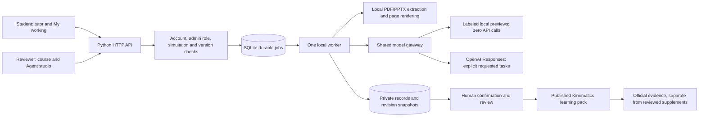

# Connected agent workflows

All six roles are implemented in the local Physics I prototype. **Paid calls are now enabled in the owner’s private local configuration**, following explicit authorization. GPT-6 Luna with low reasoning effort serves all roles. Fresh checkouts remain offline via `.env.example`. Unit and workflow tests use mocked providers; two small synthetic live checks verify access and basic response behavior, not live handwriting or exam-grading quality.

## Runtime

`kinematics/gateway.py` is shared by Tutor, Reader, Builder, Evaluator, Curator and Scout. It validates strict schemas locally, enforces shared session/day/month spending allowances, records agent/model/prompt/usage metadata, reserves cost before dispatch, and permits one generation at a time. It does not retry paid calls automatically. Existing historical tutor charges remain part of the shared meter.

`AI_PAID_CALLS_ENABLED=false` and `AI_EXECUTION_MODE=offline` keep execution offline, with or without a key. These remain the example defaults; the owner’s local flags are now `true` / `live`, with `AI_REASONING_EFFORT=low`. Enabling live execution later requires both `AI_PAID_CALLS_ENABLED=true` and `AI_EXECUTION_MODE=live`. A task records offline mode when queued; enabling paid mode does not turn a queued offline task into a paid request. One `OPENAI_API_KEY` serves all model roles. No key or unrestricted filesystem/database tool is exposed to a model or browser.

Text contexts are bounded to 60 KB, model output to at most 4,000 tokens (usually less), and vision to three downscaled pages. Conservative image/text reservations apply before any live dispatch. Failed or ambiguous requests retain an estimated reservation; provider billing remains authoritative. There are no hosted vector stores, embeddings, paid tools, automatic source-vision batches or paid supervisor loops.

## Application permissions and records

The **sole administrator account** is provisioned through a random private, single-use local setup link. Public registration always creates students; a database constraint permits only one admin. Admin accounts own course drafts and are automatically the academic reviewer across logins. Students cannot open Course studio or Agent studio, invoke authoring/review APIs, or claim reviewer permissions. Private learning data follows each signed-in account. Passwords are salted scrypt hashes; random, hashed, expiring sessions rotate at login and are revoked at logout/password change. University SSO, verified email and recovery remain future work before deployment beyond loopback.

SQLite tables store durable jobs, private records, immutable revision snapshots, aggregate signal categories, coarse study-time totals and deduplicated resource votes. Job states are `queued → running → complete/failed`; a server restart marks running tasks interrupted instead of retrying. Reusing a job ID for the same task is idempotent; a different task cannot reuse it. Model network calls do not hold a database write transaction.

## 1. Reader

**Source profile:** extracts native PDF/PPTX text locally and preserves page locations. Reviewer-selected PDF pages can be sent individually to vision only in live mode. Candidate text, uncertainty and theory/question/solution boundaries remain unconfirmed. The reviewer sees the original rendered page and can edit transcription before confirmation. Native extraction may reorder equations or omit diagrams.

Only confirmed theory pages from lecture files without a solution flag, explicitly checked as answer-free, can support official student retrieval. Question, solution, mixed and unknown pages stay restricted to authoring. Classification changes invalidate dependent publications. Source and content revisions are checked again before publication and retrieval.

**Student profile:** accepts typed working or PDF/PNG/JPEG/WebP files, maximum 8 MB; PDF submissions are limited to three pages. The Reader sees the student's pages and public question prompt, with no answer key. Live instructions preserve wrong mathematics instead of reconstructing an expected solution. Offline mode preserves typed/native text and requires manual image transcription. Uncertain symbols are shown for confirmation. Confirming creates a locked text/answer snapshot and question hash; later edits require a new submission.

PDF extraction/rendering runs in a local subprocess with time/page limits and no OpenAI credentials. `DOCUMENT_PYTHON` can select an installed interpreter with pypdf, pypdfium2 and Pillow; this Mac's bundled Codex runtime is discovered automatically. PPTX text extraction uses ZIP/XML parsing without expanding files into arbitrary directories.

## 2. Course Builder

Confirmed answer-free lecture evidence is required before a structure proposal. Structure units use only the six core Kinematics IDs. The reviewer can remove unsupported units and edit objectives and source selections. Structure approval precedes lesson drafting.

Content drafting receives exact approved structure/source versions, with a bounded, separately labeled reviewer-only question/solution bank when available. Lessons, equations, checkpoint prompts, staged hints, candidate reference answers and rubrics are editable. The model cannot publish. Generated or template answers are not called official solutions.

Content review and publication are separate actions. Publication creates a versioned Kinematics learning pack under **Reviewed additions** on the existing level map. The initial student payload excludes staged hints, reference solutions, rubrics and restricted source pages. Question work can be submitted through My working for formative evaluation. No other playable course level is created. Changed source, structure or content versions make affected packs unavailable to retrieval.

Offline drafting uses labeled local templates. It does not infer coverage from the uploaded file. Human review must remove unsupported topics and verify every source reference before publication. No main-workspace teaching content was approved or published during implementation testing; the browser publication check used a separate QA database.

## 3. Tutor

The bottom-right chat retains private per-session history, server-resolved page/question context, optional own work context and bounded retrieval. It receives official evidence and reviewed collective supplements in separate fields. Citation identities are allowlisted. Published source previews expose only released page IDs; originals and whole solution files have no public route.

Current official evidence takes priority over reviewed supplements and older personal history. Source instructions cannot authorize new actions. Offline mode returns a labeled course-note preview without pretending to generate a personalized or translated answer. Live explanations can use the requested language with English technical terms.

Any unsubmitted simulation blocks agent assistance across pages. Workflows recheck simulation state at dispatch and result delivery. This is not proctoring. The app records tutor assistance separately from independent numeric checkpoint evidence.

## 4. Evaluator

Evaluation requires a locked submission with the current question version and an explicitly reviewed reference rubric. Built-in checkpoint references are approved in Agent studio; published pack rubrics are reviewed as part of its publication. The Evaluator receives the locked work, reviewed criteria/reference and deterministic numeric checks. Its feedback addresses setup, method, mathematics, units and result, with uncertainty and review flags.

An incorrect deterministic result cannot be presented as secure overall readiness. A correct number alone does not establish reasoning quality. The Evaluator never awards official grades, mastery or XP. Offline mode returns actual numeric checks and an explicit reasoning-review placeholder. Students can request local review of a dispute only by explicitly sharing the relevant transcription and feedback; that record is separate from aggregate cohort inputs.

## 5. Curator

Inputs contain thresholded question-attempt statistics, structured help/clarity categories and coarse study-time aggregates. Groups below five distinct signed-in student accounts are suppressed. Accounts are self-registered, not university-verified; synthetic test counts stay in isolated test databases. Individual chat text, notes, submissions and images never enter the Curator prompt.

Insufficient data produces a local result without a model call. Eligible groups can produce editable FAQ drafts and clarification tickets. Reviewer approval is required before FAQs enter shared retrieval as **collective supplements**. A learner's explicit wrong-reference flag can create an immediate local clarification ticket without exposing their private chat. Study time is a coarse visible-page signal, not a mastery score or causal proof.

## 6. Resource Scout

The reviewer supplies a URL and concept. The fetcher accepts public HTTPS HTML/plain text only, validates every DNS result, pins the connection to a validated IP with TLS hostname verification, revalidates redirects, blocks credentials/private/metadata addresses and nonstandard ports, and limits redirects, time and response size. It does not execute page scripts or automatically follow links.

Fetched URL/title/text are stored with provenance and a hash. The Scout proposes relevance, level, useful objectives and cautions; it cannot invent a verified URL or automatically publish a recommendation. Approved resources remain labeled supplements. Helpfulness votes count once per student account and are displayed only after five distinct student accounts. Automatic web discovery and causal learning-outcome validation remain future work.

## Implemented API routes

| Route | Purpose |
|---|---|
| `GET /api/agents` | Admin-only dashboard, authoring records and review tools |
| `GET /api/workspace` | Own student work, evaluation records and assistance jobs |
| `GET /api/auth` | Current account, or null |
| `POST /api/auth/register` / `login` / `logout` | Student registration and session lifecycle |
| `POST /api/auth/setup` | Single-use private admin provisioning |
| `POST /api/profile` / `password` | Own profile and password updates |
| `GET /api/admin/students` | Admin-only student account roster |
| `POST /api/agents/reviewer` | Admin-only compatibility check; no public reviewer claim |
| `GET /api/jobs/:id` | Read an owned durable job |
| `POST /api/studio/courses/:id/process` | Native source extraction or explicitly selected source-page reading |
| `POST /api/agents/records/:id/source-confirm` | Confirm selected page text, boundary and answer-free status |
| `GET /api/agents/records/:id/source-preview?page=N` | Own original-page preview |
| `POST /api/studio/courses/:id/structure-drafts` | Structure task |
| `POST /api/studio/courses/:id/content-drafts` | Lesson/checkpoint task after structure approval |
| `POST /api/agents/records/:id/review` | Save edits, approve/reject a version or resolve a review |
| `POST /api/agents/records/:id/publish` | Publish reviewed Kinematics content separately |
| `GET /api/packs` / `GET /api/packs/:id` | Safe, active student learning packs |
| `GET /api/packs/:id/source/:extraction/:page` | Exact released source page |
| `POST /api/work` / `POST /api/work/upload` | Private typed work or image/PDF upload |
| `POST /api/work/:id/read` | Student-profile Reader task |
| `POST /api/work/:id/confirm` | Lock a confirmed transcription and numeric answers |
| `POST /api/agents/rubrics` | Approve a current built-in reference rubric |
| `POST /api/work/:id/evaluate` | Formative evaluation task |
| `POST /api/evaluations/:id/dispute` | Consented local reviewer request |
| `POST /api/tutor/messages` | Private tutor response |
| `POST /api/agents/curate` | Thresholded cohort analysis task |
| `POST /api/agents/scout` | Reviewer-supplied resource task |
| `POST /api/signals` / `POST /api/signals/time` | Local structured feedback and coarse study intervals |
| `POST /api/resources/:id/vote` | Deduplicated helpfulness vote |

## Validation and remaining work

Run `python3 -m unittest discover -s tests -p 'test_*.py' -v`. Tests use temporary databases, fake providers and fake resource fetches. They cover offline dispatch, strict schemas, budget sharing, idempotency, session/reviewer ownership, stale sources, staged publication, answer-key isolation, transcription preservation/locking, reviewed-rubric gating, simulation restrictions, cohort thresholds and unsafe network targets. Native extraction/rendering was also checked on a supplied lecture PDF. Browser QA uses an isolated database, not the user's actual review records.

Live model quality, OCR accuracy, physics grading agreement and multilingual correctness still need deliberately enabled, small benchmark runs before wider use. University identity, account recovery, backup/retention policy, malware scanning, cloud hosting, scheduled notifications and automatic web discovery are not claimed by this local implementation.
