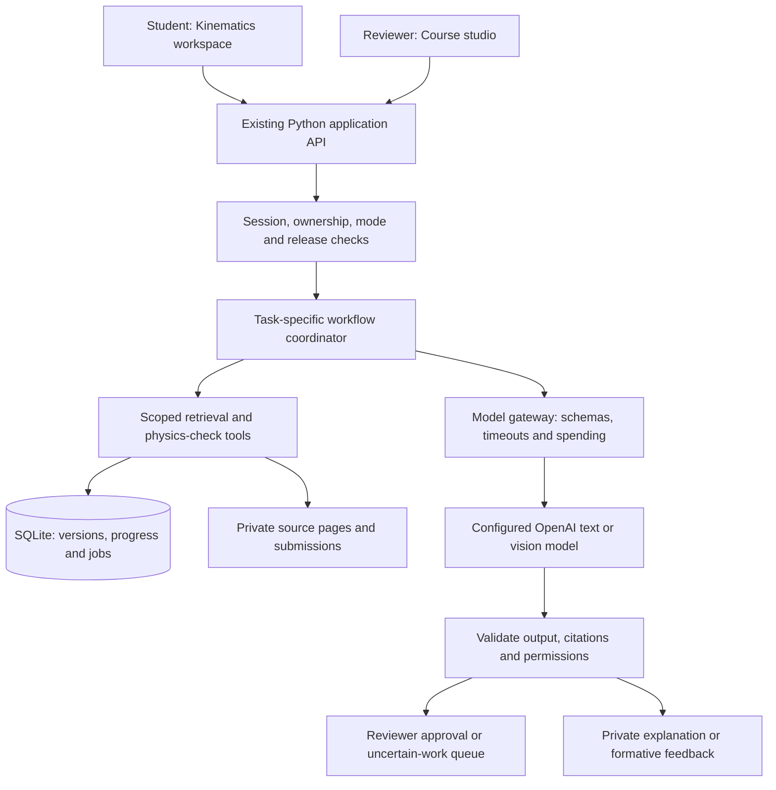
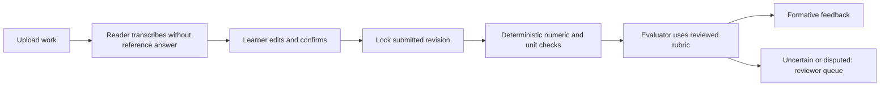

# AI agents: implementation proposal for review

Status: all six roles have connected prototype workflows as of 7 November 2026. Paid calls are disabled at the user's request. Offline previews and mocked providers verify routing, permissions and review gates without establishing live model quality. Kinematics remains the only playable level.

Implemented: shared budgeted gateway; Reader source and student profiles; private Tutor; locked-submission Evaluator; reviewed structure/content Builder; thresholded Curator; reviewer-supplied-URL Scout. Source extraction, course drafts, review decisions, published packs, jobs and private submissions persist locally. See [the implementation guide](AGENT_WORKFLOWS.md) for actual endpoints and current limitations.


## 1. What changes and what stays under application control

Add AI capabilities to the current Python backend and browser interface. Retain SQLite, private local files, course-draft ownership and existing numeric checks for the first increment. Do not require a Next.js/FastAPI/PostgreSQL migration just to connect the first tutor.

An agent is a backend task with a specific instruction set, allowed tools, input/output schema, model setting and execution budget. The six roles below can share models; they are invoked only when their workflow requires them. They do not all run on each question. Use application code for routing initially, rather than a paid supervisor model that decides every action.

The application retains exclusive control of access checks, publication, timers, attempt locking, source versions, XP, mastery evidence, job retries and cost limits. Models propose content and evaluations; they do not receive unrestricted database access or publication tools.

The present course studio is session-owned, not institutional professor authentication. The first implementation remains a local reviewer/learner demonstration. Real account/role authorization is required before a cohort deployment, and UI view switching must never grant production privileges.

## 2. The six roles

| Agent | When it runs | Reads | Produces | Cannot do |
|---|---|---|---|---|
| **Document & Handwriting Reader** | Course-source processing or student-work upload | Selected source pages in reviewer mode; only the student's submission and question in learner mode | Text/equation transcription, diagram descriptions, question/solution boundaries, uncertain regions and page references | Silently correct the author's mathematics, approve sources, grade work or mix reviewer and learner contexts |
| **Course Builder** | Reviewer requests a Kinematics structure, lesson or question/rubric draft | Reviewer-permitted sources, confirmed extraction, syllabus objectives, approved prerequisite map | Editable unit structure, cited explanations, question mappings, hints and candidate rubrics | Publish content, call generated solutions official, create other playable levels under this scope |
| **Physics Tutor** | Learner asks a personal question, requests an explanation or a permitted practice hint | Published official evidence, separately labeled reviewed supplements, own relevant learning summary | Cited, level-adapted explanation in the chosen language, English technical terms, focused follow-up or next practice suggestion | Read other learners' history, fetch restricted reference answers or provide hints during a simulation |
| **Assessment Evaluator** | Confirmed work is submitted at an allowed feedback stage | Locked submission, exact reviewed question/rubric/reference versions, deterministic checking results | Feedback on setup, assumptions, method, mathematics, units and result; misconception tags and review flags | Change the submitted work, issue an official course grade, independently award XP/mastery or publish answers |
| **Cohort Curator** | Reviewer runs an aggregate-analysis batch | Thresholded concept/question statistics, sanitized issue categories and published sources | FAQ drafts, recurring-misconception summaries and clarification tickets | Search raw private tutoring conversations, expose individual students or promote popular material to official truth |
| **Resource Scout** | Reviewer requests enrichment or supplies a candidate URL | Course concept/objective, permitted public pages, existing reviewed-resource metadata | Source-attributed supplementary resource proposals and reasons for relevance | Invent verified links, override official course conventions or automatically publish recommendations |

The Reader has **two separate task profiles and data scopes**, even if one vision-capable model handles both. In student-transcription mode it must not see the reference answer: otherwise it may unconsciously reconstruct a correct solution instead of preserving the student's actual work. Source transcriptions require reviewer confirmation; student transcriptions require student confirmation.

## 3. How the roles connect to the current app



Use the OpenAI Responses API through a backend adapter. Function calls expose selected application tools; the backend validates and executes each request. Structured outputs give drafts, transcriptions and evaluations predictable shapes, but do not establish that their contents are correct. The implementation should handle incomplete/refused responses and schema-validation failures explicitly. [Function calling](https://developers.openai.com/api/docs/guides/function-calling), [Structured outputs](https://developers.openai.com/api/docs/guides/structured-outputs)

A separate hosted agent service or Agents SDK is not required for this prototype. Ordinary functions can coordinate the workflows. Keep a provider-independent boundary so a later provider/model change does not require rewriting the course interface.

Example backend tools:

```text
search_published_official(query, concept_ids, limit)
search_reviewed_supplements(query, concept_ids, limit)
load_own_learning_summary()
load_authorized_page(source_version_id, page)
check_quantity(validated_expression, expected_reference_id)
propose_content_draft(type, cited_payload)
propose_clarification(question_version_id, reason)
```

The session, course scope and actor privileges are injected by the backend. Model-supplied IDs cannot select another learner or widen access. A tool registry gives each task only the functions it needs. Assessment references are supplied through the evaluator workflow, not a general tutor search tool.

## 4. Knowledge and memory boundaries

| Store | Purpose | Release rule |
|---|---|---|
| **Source inbox / draft index** | Uploaded originals, extraction candidates and proposed question/solution splits | Reviewer only; uploading does not publish |
| **Official published index** | Approved course explanations/evidence with exact source locations and versions | Eligible student retrieval within the released level |
| **Reviewed collective index** | Approved FAQs, supplemental explanations and outside resources | Clearly labeled supplementary evidence; cannot override official sources |
| **Private learning store** | Own questions, confirmed submissions, attempts, preferences and concept-level evidence | Own-session/own-account scope only |
| **Aggregate signals** | Distinct-learner counts, safe misconception categories and resource feedback | Minimum group size before cohort display or analysis |

For the first tutor, prepare the approved Kinematics passages and necessary units/vector prerequisites. Use existing selected lecture pages as the initial review set. Searching draft documents, whole solution PDFs or unrelated course sections must not bypass a release restriction.

Keep each student's memory compact: explanation language, concept evidence, recent relevant mistakes and a short conversation summary. Retrieve original attempt references when needed. Do not replay all chats or send everyone's context on every turn.

Start retrieval with local keyword search and explicit concept/page links, then add embeddings if the evaluation set shows a need. Version embedding configurations if used. Retrieve a small evidence set, expand deliberately for multi-part questions and retain citations to original pages. Cache approved evidence/resources across learners; keep personalized answers private. Source corrections invalidate affected resources and caches.

Sharing useful teaching content means drafting a generalized explanation from approved evidence and aggregate misconceptions, then reviewing it. It does not mean copying a learner's private conversation into shared retrieval. Improve content/retrieval/recommendations first; model fine-tuning is outside this implementation.

## 5. The three priority workflows

### A. Personal tutoring

1. Learner opens “Ask about this” in a Kinematics unit and chooses an explanation language.
2. Backend resolves the level, current mode and own learning profile.
3. Retrieve published official evidence and any separately labeled reviewed supplement.
4. Tutor answers at the appropriate depth with source-page citations. It answers a clear question directly; diagnostic follow-ups are used only when useful.
5. Backend verifies citation identities/permissions and stores the response privately. Record a minimal structured signal if a misconception is observed.

Cold-start knowledge is **unknown**, not automatically beginner. Offer a short diagnostic or infer cautiously from checkpoint evidence. Self-reported confidence and demonstrated knowledge are distinct. Personalization changes examples, depth and pace, not the correctness standard.

In exam-simulation mode, restrict assistance server-side. The tutor must not provide help on an active simulation item through a different app workflow. This remains a practice simulation, not protection against outside tools or proctoring.

### B. Handwritten work and feedback



Preserve the upload, transcription revisions and submitted snapshot. Highlight ambiguous minus signs, exponents, subscripts, vector arrows and diagram labels. Never silently replace a wrong equation with the expected one.

Retain the existing numeric checks; add bounded unit handling next. Symbolic equivalence comes later and must use a restricted parser, declared variable domains and resource limits. Matching a final value does not demonstrate correct reasoning. Conflicts between deterministic checks and model feedback require review rather than a confident mark.

Practice can return feedback and staged hints. Simulation returns evaluation only after final submission. The evaluator may receive restricted references, but learner-visible feedback must obey the solution-release policy.

### C. Course-source processing and authoring

1. Existing course-studio upload records create durable processing jobs; original files remain private.
2. Extract native PDF/PPTX text locally and render diagrams/pages as needed.
3. Reader processes only pages requiring visual interpretation, preserving source locations and uncertainty.
4. Reviewer confirms transcription and question/solution separation, including same-page answers and highlighted options.
5. Course Builder proposes a Kinematics unit structure; reviewer approves the structure.
6. Builder drafts lessons, checkpoints, hints and rubrics; reviewer previews and approves each before publication.

Questions without official solutions may receive an AI-drafted reference, explicitly labeled as generated. It cannot support mastery scoring until reviewed. The unresolved past-exam date and polar/cylindrical source gap remain visible. No other playable levels are generated automatically.

## 6. Cohort improvement and outside resources

Implement these after tutoring and assessment work reliably:

- Produce sanitized signals during individual workflows. Do not send raw private chat or learner images to the Curator.
- Initially require at least five distinct learners before cohort patterns are displayed. The local single-learner demo should report insufficient data; synthetic test signals must be labeled.
- Group repeated ambiguities into a ticket containing the affected question/source version, aggregate evidence and a proposed clarification. The reviewer decides the correction.
- A serious correctness report enters review immediately, even without a group threshold.
- Launch Resource Scout with reviewer-supplied URLs first. A later web-search integration may discover new resources, subject to the agreed budget. Validate fetched-page provenance and reject unsafe URL destinations.
- Treat helpfulness votes as one signal. Look at later independent attempts as well, and do not call observational improvement proof of causation.
- All shared FAQs, explanations and outside resources require review, versioning and visible authority labels.

## 7. Integration endpoints and persistent records

The table below records the original endpoint proposal. Actual implemented routes and scope are documented in [AGENT_WORKFLOWS.md](AGENT_WORKFLOWS.md).

| Endpoint/workflow | Role |
|---|---|
| `POST /api/studio/courses/:id/process` | Queue local extraction and source Reader tasks |
| `POST /api/studio/courses/:id/structure-drafts` | Course Builder proposes a Kinematics structure |
| `POST /api/studio/reviews/:id/approve` | Application-only version-specific reviewer action |
| `POST /api/tutor/messages` | Private Tutor conversation |
| `POST /api/attempts/:id/work` | Private handwriting upload and Reader job |
| `POST /api/attempts/:id/transcription/confirm` | Lock confirmed transcription |
| `POST /api/attempts/:id/evaluate` | Evaluator at an eligible feedback stage |
| `POST /api/studio/insights/refresh` | Curator over eligible aggregate signals |
| `POST /api/studio/resources/propose` | Resource Scout candidate workflow |

Add records for jobs, agent runs, source/extraction versions, publication approvals, conversation/message ownership, submission revisions, rubric versions, concept evidence, aggregate signals and resource candidates. An agent run stores model/prompt/schema versions, evidence references, status, token/cost usage and an error category. Keep private text and images out of general logs.

Use a durable job table and one local worker initially; the browser polls job status. Record cancellations/timeouts, allow safe retries and prevent duplicate submissions, approvals or XP. External model calls must not hold a SQLite write transaction open. Commit job state before calling the provider, then validate/store the result in a short transaction.

## 8. Model, credential and cost choices

Use configurable text/reasoning and vision-capable model roles. A single capable model may initially serve multiple agents. Select exact identifiers after a small Kinematics benchmark and checking the user's account access; do not commit to an untested cheapest-model assumption.

The key stays in the private local environment file and is loaded only by the backend/worker. There are no browser-visible keys. No key is needed for this plan review.

Before paid calls are enabled, agree a small session/monthly allowance. Bound input/output tokens, image pages, tool steps, concurrent runs and retries. Reserve estimated cost before dispatch and reconcile reported usage afterward. The app stops further dispatch when its allowance is exhausted; provider usage reporting may lag, so application metering is not an absolute billing guarantee.

Start with serial vision jobs and limited interactive concurrency. Batch and cache source extraction so slides are not repeatedly transcribed for every learner. Do not send the full 1,697-page corpus with each message.

## 9. Recommended build order and review gates

| Increment | Implement | Demonstrate before moving on |
|---|---|---|
| **1. Foundation + Tutor** | Model gateway, budget control, run records, published Kinematics retrieval, private chat UI, selected-language explanations | Accurate page-cited answers, sensible cold-start behavior, out-of-scope handling and private-memory isolation |
| **2. Reader** | Student/source task profiles, image/PDF input, uncertain-region output, editable confirmation and saved revisions | Preserve deliberately wrong handwritten work; do not correct it toward a hidden reference |
| **3. Evaluator** | Reviewed rubrics, formative reasoning feedback, deterministic-check integration and disputes | Agreement with reviewer-scored held-out answers; ambiguous work routes to review; simulation feedback withheld |
| **4. Course Builder** | Studio processing jobs, extraction review, structure approval and content-draft/publication workflow | Rebuild a reviewable Kinematics unit from actual source documents without releasing mixed answer material |
| **5. Curator + Scout** | Aggregate patterns, clarification queue, reviewed FAQ/resource proposals | No private-chat leakage, no invented cohort patterns and no automatic promotion of outside material |

Reader/source-processing support can be introduced earlier if the approved tutor evidence needs it. The existing lecture extraction and selected page previews allow a small Tutor-first increment without pretending that the entire source inbox has already been processed or approved.

Acceptance checks include unsupported claims and missing evidence, source corrections, malicious document instructions, cross-session access attempts, answer-key leakage through tools/citations, multilingual terminology errors, transcription errors, rubric disagreements, simulation assistance restrictions, repeated-job/XP idempotency and provider timeout/budget handling. Report results by task type, not just an aggregate success score.

## 10. Decisions for this review

Recommended defaults:

1. Approve the six roles and phased order above, starting with Foundation + Tutor for Kinematics only.
2. Use the supplied official materials first. Outside-resource proposals come later and need review.
3. Keep all AI assessments formative, with provisional concept evidence and reviewer escalation.
4. Keep your role as the demonstration academic reviewer; do not label those approvals as professor approvals.
5. Choose the API spending allowance before enabling paid calls. Exact model selection follows the short benchmark.

All role workflows are now implemented. Live quality benchmarks, institutional authentication, verified cohort identities and production deployment remain separate validation work.
